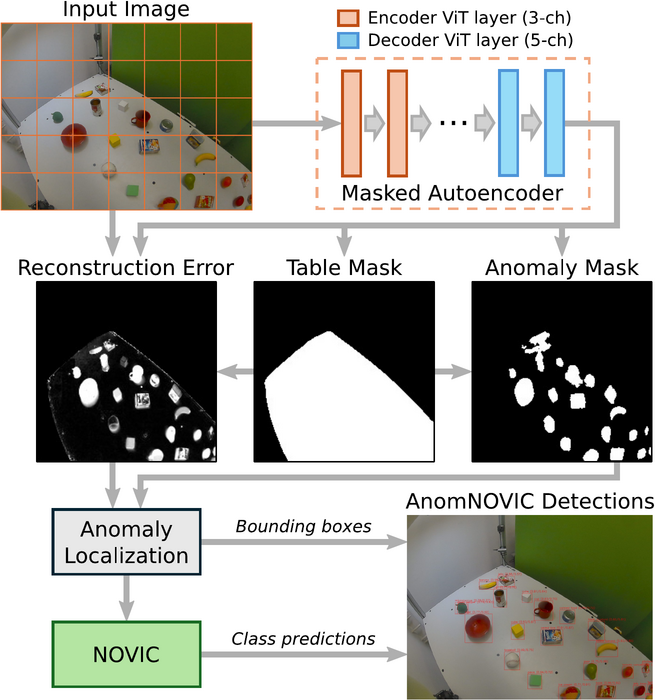
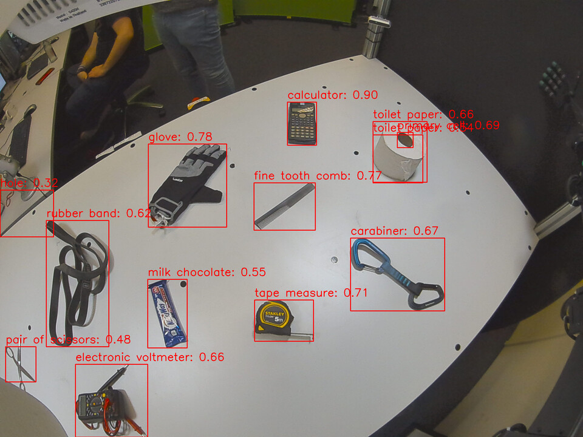

# AnomNOVIC: Identifying the Unknown

[](https://doi.org/10.1007/978-3-032-38401-0_43)
[](https://arxiv.org/abs/2606.26829)
[](LICENSE)

**Main Author:** Philipp Allgeuer

Code release corresponding to the published paper:

- **Paper:** Philipp Allgeuer, Jan-Gerrit Habekost, and Stefan Wermter: *Identifying the Unknown: Prompt-Free Open Vocabulary Anomaly Recognition for Robot-Object Interaction*, ICANN 2026 [[Springer]](https://doi.org/10.1007/978-3-032-38401-0_43) [[arXiv]](https://arxiv.org/abs/2606.26829) [[Cite]](CITATION.cff)
- **Video:** [ICANN 2026 presentation](https://youtu.be/jG82-yGra5Q)

> :bulb: **TL;DR:** AnomNOVIC finds unexpected objects in a known workspace and names them without relying on a given list of candidate classes.

## Overview

AnomNOVIC combines a masked autoencoder (MAE) with the [NOVIC](https://github.com/pallgeuer/novic) open vocabulary image classification model. The MAE reconstructs the NICOL robot's tabletop workspace (or whichever workspace was trained) and predicts table (or more generally, valid workspace) and anomaly masks. These masks and the reconstruction error are used internally to localize anomalies and extract bounding boxes. The inference pipeline then uses NOVIC to assign free-form names to the resulting image crops, and thereby perform prompt-free open vocabulary object detection.

| [](docs/images/anomnovic_pipeline.png) |
| :-: |
| *AnomNOVIC inference pipeline* |

This repository provides the code and configurations required for training, inference, and evaluation, along with links to the weights and datasets. NOVIC inference uses a supplied checkpoint, but NOVIC training is handled by the separate [NOVIC repository](https://github.com/pallgeuer/novic).

## Repository Contents

| Path | Contents |
| --- | --- |
| [`configs/`](configs/) | MAE training commands |
| [`evaluation/`](evaluation/) | NICOL evaluation mappings |
| [`src/anomnovic/mae/`](src/anomnovic/mae/) | MAE model and training |
| [`src/anomnovic/inference.py`](src/anomnovic/inference.py) | Detection and naming |
| [`src/anomnovic/evaluate.py`](src/anomnovic/evaluate.py) | COCO evaluation |
| [`docs/`](docs/) | Assets and attribution |

## Installation

Use Python 3.10+ in an environment with a PyTorch build suitable for your device.

```bash
git clone https://github.com/pallgeuer/anomnovic.git
cd anomnovic
python -m pip install -e .
```

For object classification, also clone [NOVIC](https://github.com/pallgeuer/novic) at tag `v1.0.2`, install its inference requirements in the same environment, and make its top-level `infer.py` importable.

```bash
git clone https://github.com/pallgeuer/novic.git ../novic
git -C ../novic checkout v1.0.2
python -m pip install -r ../novic/requirements-infer.txt
export PYTHONPATH="$(realpath ../novic)${PYTHONPATH:+:$PYTHONPATH}"
```

The optional SAM2 refinement step requires [SAM2](https://github.com/facebookresearch/sam2). Omit `--sam_model` from the appropriate commands to run without it. On first NOVIC inference, its CLIP image backbone will be downloaded into the local model cache.

## Datasets and Checkpoints

Refer to [dataset ZIPs](docs/datasets.md) and [checkpoints](docs/checkpoints.md) for how to download the corresponding resources for training, inference, and evaluation.

## Inference

Download a NICOL MAE checkpoint from the [checkpoint assets](docs/checkpoints.md) and a NOVIC checkpoint. The public FT0 and FT2 NOVIC weights are available as part of the [NOVIC v1.0.0](https://github.com/pallgeuer/novic/releases/tag/v1.0.0) release assets. The N-FT0 and N-FT2 weights are available through the [AnomNOVIC checkpoint assets](docs/checkpoints.md). Use the MAE trained on the dataset matching your scene.

```bash
anomnovic-infer --image_dir /PATH/TO/IMAGES --output PREDICTIONS.json --anom_model_type mae_vit_base_patch16 --anom_model /PATH/TO/mae_plain.pth --table_mask --anomaly_mask --novic_model /PATH/TO/novic_n_ft2.train
```

The command writes a JSON list of boxes, scores and free-form category names. `--declass` runs localization without NOVIC. `--show` displays images in a graphical environment. See `anomnovic-infer --help` for thresholds and other settings.

| [](docs/images/anomnovic_wild_result.jpg) |
| :-: |
| *Example predictions (restricted to the table workspace by design) on an image from the Wild test set* |

## Evaluation

To evaluate on a test ZIP containing annotations, run these commands.

```bash
anomnovic-evaluate ground-truth /PATH/TO/TEST_PLAIN_DIR /PATH/TO/GT_PLAIN.json --remap_file evaluation/nicol_label_remap.json
anomnovic-infer --image_dir /PATH/TO/TEST_PLAIN_DIR --coco_gt_path /PATH/TO/GT_PLAIN.json --output /PATH/TO/PRED_NAMED.json --anom_model_type mae_vit_base_patch16 --anom_model /PATH/TO/mae_plain.pth --table_mask --anomaly_mask --novic_model /PATH/TO/novic_n_ft2.train
anomnovic-evaluate align /PATH/TO/PRED_NAMED.json /PATH/TO/GT_PLAIN.json evaluation/nicol_category_alignment.json /PATH/TO/PRED_COCO.json
anomnovic-evaluate evaluate /PATH/TO/GT_PLAIN.json /PATH/TO/PRED_COCO.json
```

The category alignment file records which free-form nouns count as correct or close for those classes. Review unfamiliar predictions before treating the open vocabulary COCO metric as final. The label remap file allows a remapping to be specified for e.g. renaming or merging annotated classes in a test dataset.

## Training

In order to train the MAE, first extract the matching training and annotated test ZIPs, then run the matching configuration. Each training image has a corresponding `mask_*.png` table mask, and each training archive includes `virtual_anomalies/`.

```bash
bash configs/train_plain.sh /PATH/TO/TRAIN_PLAIN_DIR /PATH/TO/TEST_PLAIN_DIR /PATH/TO/OUTPUT_PLAIN_DIR
bash configs/train_distractors.sh /PATH/TO/TRAIN_DISTRACTORS_DIR /PATH/TO/TEST_DISTRACTORS_DIR /PATH/TO/OUTPUT_DISTRACTORS_DIR
```

Training configuration parameters follow the two supplied MAE checkpoints. The test images are used for validation previews only. Their annotations are not used for optimization. Refer to the [dataset notes](docs/datasets.md) for more information.

## Citation and License

See [CITATION.cff](CITATION.cff). The AnomNOVIC code and project assets are under [CC BY-NC 4.0](LICENSE) except where separate license terms apply. The paper figures and some YCB-derived virtual anomaly cutouts retain their CC BY 4.0 attribution requirements. Refer to the [third-party notices](docs/third_party.md).
